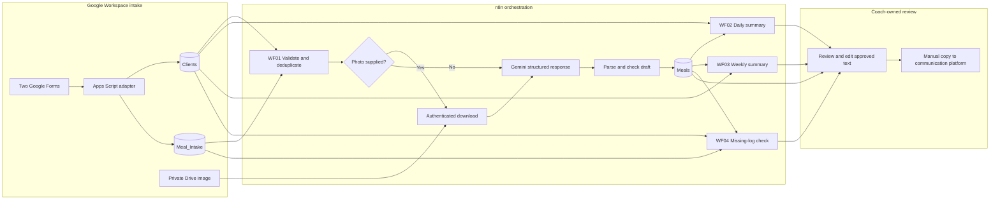

<div align="center">

# Nutrition Coach
### From fragmented meal logs to a coach-owned review workflow

**A forward-deployment case study built with n8n**

Multimodal AI · Google Workspace integrations · Human review · Eight-week tracking

[Engineering case study](docs/engineering-case-study.md) · [Demo walkthrough](docs/demo.md) · [Deployment guide 繁體中文](docs/setup.zh-TW.md) · [Workflow exports](workflows)

</div>

---

## Reliability upgrade (source implemented; live migration pending)

The four current exports write through an HTTPS **FastAPI + PostgreSQL draft gateway** for n8n Cloud (SQLite is only for local development). Unique IDs serialize competing writes; uncertain Sheets writes require read-only reconciliation. Daily/weekly jobs recover bounded missing periods, and Gemini responses must pass strict runtime shape/completion checks before persistence.

Start with the [guided installation and acceptance checklist (繁體中文)](docs/reliability-upgrade.zh-TW.md). The previous pilot evidence below describes the earlier release, not live verification of this upgrade. Existing Sheets/Gemini credentials are retained; the gateway needs a separately authorized service account for the isolated test spreadsheet. Stop the old writers before activating these exports.

## The deployment challenge

A nutrition coach needs to turn meal photos and brief messages into useful feedback for each client's goals, then maintain a consistent view across an eight-week programme. The difficult part is the operational chain: getting the right input, joining it to the right client, distinguishing missing information from failure, preserving the coach's judgment, and making the result easy to act on.

This project implements that chain using **four n8n workflows, a Google Apps Script intake adapter, and a spreadsheet-based review workspace**. It adapts an existing workflow package to a local deployment, resolves integration failures through live synthetic-data tests, and packages the result as a reusable template.

**Current status:** a working synthetic-data pilot. Forms submission, photo/text analysis, automatic meal polling, summary generation, reminder eligibility, and preservation of human edits have been exercised in an isolated environment. Production hardening remains explicitly scoped below.

### Review this project in three minutes

| Start here | What to look for |
| --- | --- |
| [Architecture](#architecture) | Clear separation of intake, AI interpretation, deterministic reporting, and human approval |
| [Engineering decisions](#engineering-decisions-that-mattered) | Item linking, OAuth file access, retries, missing-data semantics, and non-destructive reruns |
| [Verification](#what-was-actually-verified) | Live checks separated from offline tests and unverified production claims |
| [Deployment case study](docs/engineering-case-study.md) | Problem framing, delivery boundaries, debugging evidence, and customer-to-product feedback |
| [Reproduce the demo](docs/demo.md) | A concrete walkthrough with expected outputs and failure cases |

## Operational outcome

| Before automation | Implemented workflow | What stays with the coach |
| --- | --- | --- |
| Interpret each photo without a structured link to individual goals | Join each meal to a client profile before requesting AI analysis | Confirm actual consumption and relevance to the goal |
| Reconstruct daily and weekly activity manually | Calculate coverage and verified-goal progress, then draft a narrative | Review the narrative and correct unsupported statements |
| Check who has not uploaded | Compare today's clients against both pending intake and processed meals | Decide whether and when to use the reminder |
| Copy feedback between tools | Keep editable approval text beside the AI draft | Approve and manually send through the existing communication channel |

The intended value is less preparation work and a consistent review process. **No time-saving percentage, clinical outcome, adoption rate, or enterprise-scale throughput has been measured.** A proposed measurement plan is included in the case study.

## Architecture



**The automation boundary is deliberate:** there is no outbound messaging integration. Approval fields support an operator's decision; changing a status does not send a message.

### Why n8n fits this problem

- **Native integrations for the common path:** Google Sheets reads, appends, polling, and schedules stay visible in the workflow editor.
- **Code where the business rules matter:** JavaScript handles real calendar validation, course windows, stable report IDs, deduplication, and goal-progress calculations.
- **HTTP where API control is useful:** authenticated image retrieval and Gemini requests expose the request body, response format, retry configuration, and credential boundary.
- **An operator-facing handoff:** Forms and Sheets give the coach a familiar intake and review surface without introducing a separate web application.

No custom n8n node was developed for this pilot. Existing nodes plus small Code and HTTP Request steps were sufficient. A reusable node becomes justified only when the same integration need recurs; see the [product feedback proposals](docs/engineering-case-study.md#product-feedback-from-deployment-friction).

## Four workflows, four responsibilities

| Workflow | Trigger in the pilot | Responsibility | Output |
| --- | --- | --- | --- |
| [WF01 — Meal analysis](workflows/WF01-meal-analysis.json) | New-row polling every minute; manual entry point | Validate input → skip processed IDs → retrieve client goal → analyse image or text → create draft | `Meals` |
| [WF02 — Daily summary](workflows/WF02-daily-summary.json) | 08:00 daily; manual entry point | Aggregate yesterday's records within the client's course → calculate metrics → draft summary | `Daily_Summaries` |
| [WF03 — Weekly summary](workflows/WF03-weekly-summary.json) | 09:00 daily eligibility check | Generate the preceding seven-day report on course days 7, 14, …, 56 | `Weekly_Summaries` |
| [WF04 — Missing-log reminder](workflows/WF04-missing-log-reminder.json) | 20:30 daily; manual entry point | Exclude clients with today's pending or processed intake → create a reminder draft | `Reminders` |

Schedules and date calculations use **UTC+8 / Asia/Taipei**. Weekly reports follow each client's start date rather than a shared calendar week. WF04 uses a deterministic message template; it does not spend an AI request on a simple eligibility check.

## Engineering decisions that mattered

### 1. Preserve the correct item across a branched AI pipeline

The meal workflow must handle several submissions in a single run without attaching one client's context to another meal. Input validation maps every incoming item, and the workflow processes meals one at a time with linked-item lookups such as `itemMatching(0)`.

A live batch containing **two text meals and one image meal** completed through the appropriate branches. A subsequent rerun skipped all three existing records and preserved the coach's edited text and approval status.

### 2. Separate model interpretation from authoritative metrics

The model produces observations, missing-information notes, and a draft. JavaScript calculates report metrics; the coach owns `coach_goal_met`.

| Metric | Calculation | Interpretation |
| --- | --- | --- |
| Recording coverage | Recorded meal slots / expected meal slots, capped at 100% | How complete the records are |
| Verified goal progress | Coach-confirmed “yes” meals / target meals, capped at 100% | Progress supported by reviewed records |
| Unknown progress | No target, or no coach “yes/no” decisions | Insufficient evidence; not a zero score |

For example, a synthetic day with **3 of 3 meal slots recorded** has **100% recording coverage**. If the coach has not verified any goal decisions, goal progress remains **unknown**. An AI statement that a visible vegetable proves goal completion does not change that metric.

### 3. Make reruns non-destructive

Submission IDs and deterministic daily/weekly/reminder IDs support lookup-before-append behavior. Existing rows are skipped instead of overwritten, protecting approved copy.

The tradeoff is explicit: a later coach correction does not automatically recalculate an already-created report. Current exports use a durable gateway uniqueness key before appending; competing writes to the same ID cannot both own the append when they share the same PostgreSQL database (or SQLite file in local tests). A lost response requires reconciliation rather than an automatic rewrite. This is not a cross-system exactly-once guarantee. Revision-aware report regeneration remains outstanding.

### 4. Diagnose authorization separately from model quality

Private image retrieval initially failed even though the user could open the file in Drive. A file created through the n8n-authorized application was successfully downloaded and analysed, establishing a working end-to-end path without making the image public.

That result does not establish permission to every privately uploaded file. The repository documents the remaining `drive.file` access boundary and the need to validate a broader ingestion path separately. Credentials and environment-specific IDs are removed from the public exports.

### 5. Treat AI output as fallible application input

Gemini requests ask for JSON using a response schema. Parsing and output checks run before draft persistence. Live tests exposed unsupported goal-completion language; a conservative replacement was added, and the daily/weekly case was captured as a regression test.

This is a targeted mitigation, not a general factuality evaluator. Internal summaries and drafts still require human review; runtime schema validation now rejects missing/extra fields, wrong types, blank required fields and incomplete/blocked responses. Prompt-injection evaluation and a measured quality benchmark remain future work.

### 6. Design for the operating environment that exists

The pilot runs on a local Apple Silicon Mac. A Google-side form trigger normalizes input, while n8n polls Sheets, so the intake flow does not require exposing a local webhook or publishing an Apps Script web app.

The same choice creates an availability constraint: the Mac and n8n must remain running. Current exports recover missing daily reports within seven days and completed weekly reports due within fourteen days, with a five-report cap per workflow run. Older gaps require operator action; this bounded scan is not a full durable scheduler.

## What was actually verified

**Evidence date: 6 November 2026.** Live verification refers to the isolated pilot; public exports have been sanitized and reset to inactive, preview-only defaults. Raw execution payloads and account-linked screenshots are deliberately excluded from this repository.

| Check | Evidence level | Observed result |
| --- | --- | --- |
| Goal form → Apps Script → `Clients` | Live integration test | Synthetic client, personal goal, and 56-day course window written correctly |
| Meal form → Apps Script → `Meal_Intake` | Live integration test | Submission ID, normalized date, image link, and consumption uncertainty preserved |
| Text and private test-image analysis | Live API + persistence test | Gemini output written as pending-review drafts |
| New meal without clicking Execute | Live trigger test | Sheets polling automatically generated a new draft |
| Rerun after coach edits | Live regression test | Three existing meals skipped; edited approval text retained |
| Daily summaries | Live manual execution | Coverage and unknown goal progress persisted for contrasting synthetic clients |
| First-week summary | Live manual execution | Seven recorded meals / 21 expected = 33% coverage; four verified / seven target = 57% progress |
| Missing-log reminders | Live manual execution + offline edge test | Drafts generated for missing intake; pending intake suppresses a reminder |
| Course weeks 1–8; no week 9 | Offline clock-controlled tests | All boundaries passed |
| Calendar dates, zero values, batch preservation, workflow connections | Offline tests | **55 checks passed** |
| Portable release defaults and unsupported-claim example | Additional offline assertions | Passed in `tests/release.cjs` |
| Daily/weekly/reminder wall-clock execution | Not yet observed | Registration and manual runs are not presented as timed-run evidence |
| Arbitrary new private uploads / eight weeks of continuous operation | Not yet validated | Remain outside the verified scope |

Reproduce the offline checks without cloud credentials (the gateway additionally uses `pytest -q service/tests` after installing `service/requirements.txt` and pytest):

```bash
npm test
```

No npm dependencies are needed. The tests execute extracted Code-node logic with synthetic inputs and controlled dates; they do not prove OAuth, API availability, or n8n runtime item-linking behavior. Those were checked separately in the pilot.

## A customer-owned review surface

The six-tab data model keeps source intake, machine output, and human decisions distinct:

```text
Clients             Personal goals, course dates, recording expectations
Meal_Intake         Normalized submissions awaiting analysis
Meals               Observations, uncertainty, AI draft, coach decision
Daily_Summaries     Deterministic daily metrics and narrative draft
Weekly_Summaries    Individual course-week metrics and narrative draft
Reminders           Missing-intake reason and editable reminder copy
```

The coach edits `coach_approved_text` or `approved_text`, selects an approval state, and copies that version manually. Actual reply time is entered only after sending. No API key, workflow edit, or model prompt change is needed for routine review.

See the [data dictionary](docs/data-dictionary.md) for column order and the [operator guide](docs/setup.zh-TW.md#教練審核與手動複製) for the daily handoff. The current UI labels and generated feedback are Traditional Chinese; this English case study explains the implementation for an international technical audience.

## Reproduce the pilot

**Tested runtime:** n8n 2.20.0 on Apple Silicon macOS. Google Workspace and Gemini credentials are required for live execution. The model configured in the export is `gemini-3.1-flash-lite`; availability must be checked for the deploying account.

1. Create a separate test spreadsheet and standalone Apps Script project.
2. Add [Code.gs](apps-script/Code.gs), set the Script Property `NUTRITION_SPREADSHEET_ID`, and run `setupNutritionTestSystem`. The account owner approves the requested Google access.
3. Record the spreadsheet ID and the `Meal_Intake` tab's numeric `gid`.
4. Generate local copies:

   ```bash
   npm run configure -- YOUR_SPREADSHEET_ID YOUR_NUMERIC_INTAKE_GID https://YOUR_DEPLOYED_HOST
   ```

5. Follow the [gateway installation guide](docs/reliability-upgrade.zh-TW.md), create its Header Auth credential, and stop the old writers. Import the JSON files from `.local/workflows/` into n8n. Bind Google Sheets OAuth2, Sheets Trigger OAuth2, and Gemini Header Auth (`x-goog-api-key`) in the relevant nodes.
6. Submit only `TEST-` synthetic clients. Verify text first, then a private image whose application access has been confirmed.
7. Review preview output, set `PREVIEW_ONLY=false` in your local workflow copies when ready to persist, then publish only after the acceptance checks pass.

**Preview is a write gate, not a network dry run:** reads, image downloads, and Gemini calls can still occur and incur cost. Exports contain neither credentials nor environment-specific Google IDs. Setup-generated files are ignored by Git.

Use the [full deployment guide](docs/setup.zh-TW.md) for exact node names, credential bindings, troubleshooting, and schedules, and the [demo script](docs/demo.md) for an interview walkthrough.

## From pilot to production: prioritized next steps

| Priority | Gap | Acceptance criterion before rollout |
| --- | --- | --- |
| P0 | Private image ingestion | A newly uploaded private image can be retrieved through the intended credential path without public sharing |
| P0 | Live recovery acceptance | Verify the new bounded backfill and restart/reconciliation behavior in the user-owned runtime |
| P0 | Failure visibility | An invalid model response or exhausted API retry becomes visible to an operator with a safe retry path |
| P0 | AI quality and data governance | Reviewed evaluation cases, explicit consent/retention/access rules, and no unsupported claim escaping the agreed review process |
| P1 | Live migration of draft gateway | Validate the implemented single-writer ledger against the authorized Google test sheet; disable all legacy direct writers |
| P1 | Report revisions | A late verified decision produces an explicit new report revision rather than silently changing approved text |
| P1 | Scale and cost | Measure per-meal latency, API cost, quota pressure, and approval effort on a representative synthetic workload |
| P2 | Reusable integration | Promote repeated ingestion or review requirements into a shared component after reuse is demonstrated |

The pilot uses full-sheet reads and does not claim high-volume scalability. It has no custom node, managed hosting, SSO/RBAC layer, or clinical validation. These boundaries inform the next deployment scope.

## What this demonstrates for forward-deployed engineering

| Capability | Concrete evidence in this project |
| --- | --- |
| Turn ambiguity into a bounded delivery | Defined intake, individual goals, four outputs, and an explicit human-owned communication boundary |
| Work across integrations | Apps Script event handling, OAuth-backed file retrieval, n8n item linking, multimodal API payloads, and sheet data contracts |
| Debug in the deployment environment | Resolved batch processing, model availability, zero-value handling, date coercion, and rerun behavior |
| Build for operator adoption | Familiar Forms/Sheets workflow, separate editable approval fields, and an operational handoff guide |
| Exercise technical judgment | Used existing nodes, deterministic reminders, and manual delivery where added infrastructure was not justified |
| Convert delivery lessons into reusable assets | Sanitized exports, a local configuration tool, regression tests, a deployment runbook, and prioritized product proposals |

This portfolio case demonstrates implementation and deployment reasoning through a synthetic pilot. It does not substitute for evidence of enterprise production ownership, on-site engagement experience, or measured business impact.

## Repository map

```text
workflows/                     Four importable n8n workflow templates
apps-script/Code.gs             Forms, schema setup, and submission adapter
scripts/configure.cjs          Environment-specific copies in ignored .local/
tests/workflows.cjs            55 offline workflow checks
tests/release.cjs              Release defaults and AI-claim regression tests
docs/engineering-case-study.md Deployment decisions and product feedback
docs/demo.md                   Interview demo and acceptance checks
docs/setup.zh-TW.md            Detailed operator/deployment guide
docs/data-dictionary.md        Six-tab data contract
```

No license has been selected for this repository. Public visibility alone does not grant a redistribution or commercial-use license.

## Independent code review and regression CI

[7 November 2026 review](docs/code-review-2026-11-07.md) covers implementation quality, remaining operational risks and fit against the supplied n8n FDE requirements. Offline checks now run in [GitHub Actions](https://github.com/jellooooo124/nutrition-coach-n8n/actions/workflows/offline-tests.yml). The Apps Script adapter escapes formula-like form text before `appendRow`; regression tests verify literal writes without cloud access. Existing Forms response tabs and already-stored rows are not modified by this fix. This review did not repeat the historical live pilot tests.
