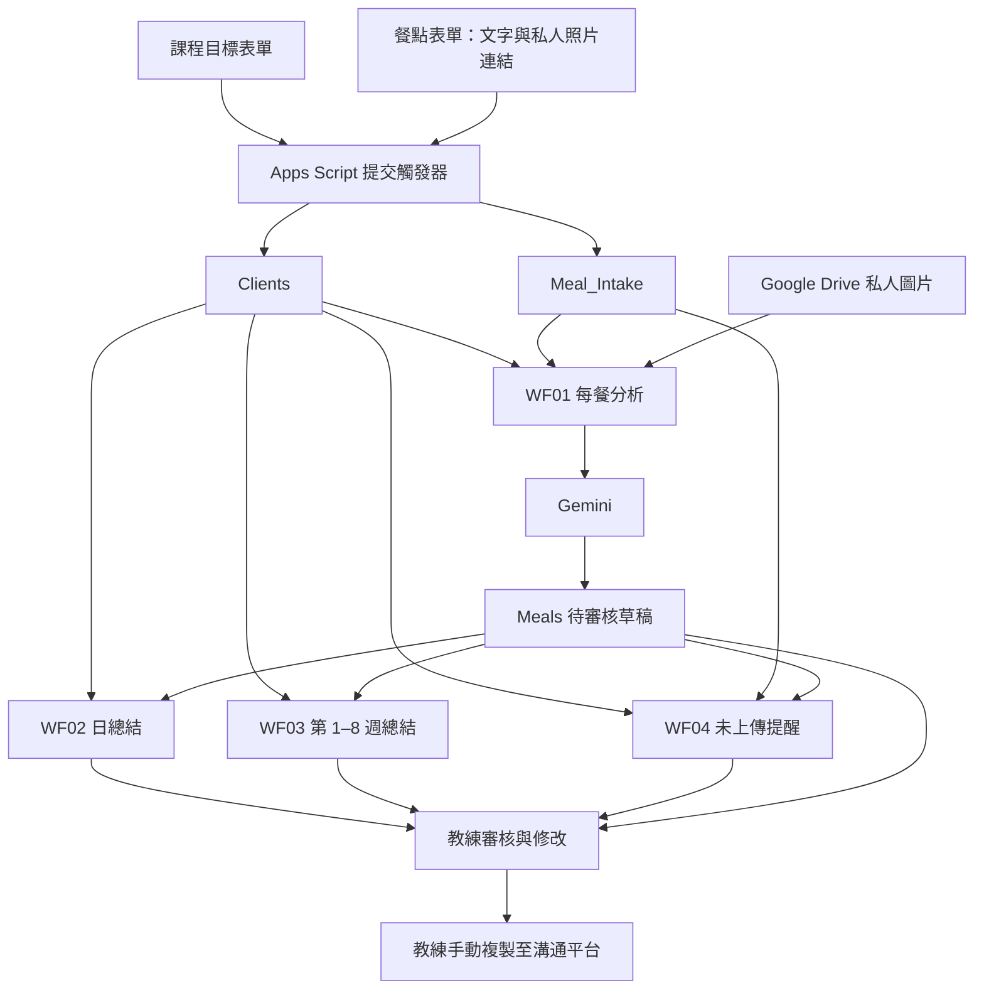

# Nutrition Coach n8n

以 **n8n、Google Sheets、Google Forms、Google Apps Script 與 Gemini** 建立八週營養紀錄追蹤。系統整理每餐照片或文字、產生日報與週報、建立未上傳提醒；所有對外文字都由教練審核、修改後手動複製到既有溝通平台。

這是一套以虛構資料驗證過的半自動工作流範本，不是可直接投入真實客戶服務的成品，也沒有對外自動發訊功能。

## 功能

| 功能 | 行為 |
| --- | --- |
| 個人目標 | 每位學員獨立設定八週起訖日、習慣目標、判斷規則、每日預期餐數與目標餐數 |
| 每餐分析 | 有照片時讀取私人 Drive 圖片；沒有照片時分析文字，保留資訊不足與待確認狀態 |
| 每日總結 | 彙整前一天紀錄、記錄覆蓋率、教練核實後的目標進度 |
| 八週週報 | 依個別課程起始日，每滿 7 天產生一週摘要，最多第 8 週 |
| 未上傳提醒 | 同時檢查已分析餐點與待分析輸入，避免已上傳但尚未分析時誤提醒 |
| 人工審核 | AI 草稿、教練核准文字、審核狀態與手動回覆時間分欄保存 |
| 避免覆寫 | 依紀錄 ID 跳過已處理資料，保留教練修改；不把重跑當成重新生成報表 |

## 流程



## 專案結構

```text
workflows/
  WF01-meal-analysis.json
  WF02-daily-summary.json
  WF03-weekly-summary.json
  WF04-missing-log-reminder.json
apps-script/Code.gs          # 建立六個資料分頁、兩張表單與提交觸發器
scripts/configure.cjs       # 在本機產生帶有你的試算表設定的副本
tests/workflows.cjs         # 日期、去重、統計及流程結構測試
tests/release.cjs           # 發布預設值與草稿過度肯定敘述回歸測試
docs/data-dictionary.md     # 完整欄位清單
```

倉庫內不含 Google 檔案 ID、n8n 憑證綁定、API key、OAuth token、資料庫、執行紀錄或客戶資料。JSON 中的 node ID 僅為流程圖內部識別碼。

## 環境與必要帳號

- 已有的端到端測試環境：Apple Silicon Mac、本機 n8n **2.20.0**。
- Google 帳號，能建立 Sheets、Forms、Apps Script 並核准腳本所需權限。
- Gemini API 使用權及可用模型。範本使用 `gemini-3.1-flash-lite`；這是既有實測設定，部署時仍需確認帳號可用性與費用。
- Node.js 用於本倉庫的零依賴設定工具與測試；`package.json` 設為 Node 20 以上。**這不是 n8n 的執行環境相容性宣告**，n8n 版本需搭配其支援的 Node.js。

本機可透過已安裝的 n8n 或官方套件啟動。若沿用相同版本：

```sh
npx n8n@2.20.0
```

打開 `http://localhost:5678`。Google OAuth 的 callback URL 請使用你自己的 n8n 憑證畫面顯示值，不要複製其他環境的設定。

## 1. 建立獨立測試試算表與表單

1. 新建一份空白 Google 試算表，記下網址 `/d/` 與 `/edit` 之間的 spreadsheet ID。
2. 新建 Google Apps Script 專案，將 [Code.gs](../apps-script/Code.gs) 放入編輯器。
3. 在「專案設定 → 指令碼屬性」新增：

   | 名稱 | 值 |
   | --- | --- |
   | `NUTRITION_SPREADSHEET_ID` | 上一步的新試算表 ID |

4. 儲存後選擇 `setupNutritionTestSystem`，執行並由帳號擁有人完成 Google 授權。
5. 確認執行紀錄顯示兩張表單的編輯連結；在 Forms 取得填答連結。
6. 確認 Apps Script 的觸發器中有 `nutritionOnFormSubmit`，事件為試算表「提交表單時」。
7. 在 Google Sheets 選取 `Meal_Intake` 分頁，記下網址中的數字 `gid`。

設定程式只為空白標頭寫入欄名。若既有欄名不一致，會停止而不是覆蓋；請使用新表測試。重跑會沿用 Script Properties 中保存的表單 ID，並重新建立同名提交觸發器。不要直接刪除這些屬性，否則再次執行可能建立另一組表單。

提交表單後，原始回覆留在 Google 自動建立的回覆分頁，Apps Script 再將欄位整理到 `Clients` 或 `Meal_Intake`。**請用正式填答連結測試，Forms 預覽模式不能提交。**

表單預設是照片 **Drive 連結欄位**，不是已配置完成的檔案上傳題。部署後請檢查 Forms 的發布與填答者存取設定，只提供給預定的測試者。

## 2. 產生你的工作流副本

在下載或 clone 後的專案目錄執行：

```sh
npm run configure -- YOUR_SPREADSHEET_ID 123456789
```

第二個參數是 `Meal_Intake` 的實際 gid。指令會把四個已替換設定的 JSON 寫入 `.local/workflows/`。此目錄已加入 `.gitignore`；不會修改倉庫內的通用範本，也不會連線到 Google 或啟用 n8n。

在 n8n 分別選擇 **Import from File**，匯入這四份副本。所有範本的 `active` 都是 `false`，沒有固定 workflow ID。請勿在已安裝的環境重複匯入並同時啟用多組相同流程。

## 3. 綁定憑證

| 節點 | n8n 憑證／設定 |
| --- | --- |
| 所有 Google Sheets 讀取與新增列節點 | Google Sheets OAuth2 |
| WF01 的 Google Sheets Trigger | Google Sheets Trigger OAuth2 |
| WF01「Google Drive 下載照片」 | HTTP Request 的預定義 Google Sheets OAuth2 憑證，沿用實測的檔案存取方式 |
| 所有 Gemini HTTP Request | Header Auth，名稱 `x-goog-api-key`，值為自己的 Gemini API key |

範本沒有包含任何憑證 ID，所以必須在每個需要憑證的節點重新選取。不要把 key 放進 JSON、Code 節點或 README。

### 私人照片權限的實際限制

已驗證的照片是由同一 n8n 授權應用建立的私人測試檔案。使用者在 Drive 網頁另行上傳的照片，**即使 Google 帳號相同，也不保證 n8n 的 OAuth 應用能讀取**；`drive.file` 不是整個 Drive 的讀取權。

請先用一張無個人資訊的虛構餐點圖片測試下載節點，再測試 AI。若回傳 403／404，檢查帳號、檔案 ID、檔案是否對該應用授權，以及 OAuth scope。必要時另設 Google Drive OAuth2 憑證並由帳號擁有人核准，修改下載節點的憑證類型後重新測試。這個替代路徑尚未在本範本完成端到端驗證。

不要為了排除權限錯誤把私人照片公開。無須開啟公開 webhook 或部署 Apps Script Web App；此版本靠 Google 的提交觸發器與本機 n8n 輪詢運作。

## 4. 先預覽，再允許寫入

每份工作流都有一個 Code 節點包含：

```js
const PREVIEW_ONLY=true;
```

這個開關只阻止**寫入輸出分頁**，不會阻止 Google 讀取、照片下載或 Gemini 請求；預覽仍可能產生 API 費用。

| 工作流 | 切換預覽的 Code 節點 |
| --- | --- |
| WF01 | 整理逐餐 AI 草稿（永遠待審核） |
| WF02 | 整理日報表與安全開關 |
| WF03 | 整理週報表與安全開關 |
| WF04 | 找出今天尚未上傳的客戶 |

先手動執行並檢查預覽結果，再在自己的 n8n 副本把 `PREVIEW_ONLY` 改為 `false`。這不會啟用對外發訊，所有新增列仍為待教練審核。

目前所有流程只處理 `TEST-` 開頭的虛構學員，且摘要／提醒要求 Clients 的 `active` 為 `是`。不要只移除字首檢查就視為完成正式部署。

## 5. 跑一次完整測試

1. 用目標表單建立 `TEST-8WK-001`；設定開始日、每日預期餐數 3、目標餐數 1，以及可由教練確認的蔬菜習慣指標。
2. 用餐點表單提交一筆文字餐點，確認 `Meal_Intake` 出現 `FORM-分頁ID-列號` 的 submission ID。
3. 手動執行 WF01，先看預覽；允許寫入後再執行，確認 `Meals` 新增草稿。
4. 用可授權讀取的虛構照片再提交一筆，確認經過照片下載與 Gemini 路徑。
5. 編輯 `coach_approved_text`、`coach_goal_met` 與 `review_status`，再重跑 WF01：既有紀錄應跳過且保留修改。
6. 準備前一天且落在課程內的虛構紀錄，手動跑 WF02。沒有紀錄的學員應顯示 0 覆蓋率，未核實目標應保持未知。
7. 另用起始日為七天前的測試學員跑 WF03，確認第一週期間與總計；今天若不是滿週日，沒有輸出是預期結果。
8. 跑 WF04：今日沒有輸入的測試學員會有提醒；已有 `Meal_Intake`、即使還沒分析，也不應被提醒。
9. 確認無誤後發布工作流，再新增一筆餐點；等候輪詢，確認不用點 Execute 也能產生新草稿。

`seedNutritionDemo` 是可選的虛構資料輔助函式，會加入測試學員與過去七天示範餐點；它不會替你建立一筆新的照片輸入。若要精準測試新環境，優先走表單流程。

## 排程與日期

| 工作流 | 預設排程（Asia/Taipei） | 產出範圍 |
| --- | --- | --- |
| WF01 | 每分鐘檢查新列 | 新增的 Meal_Intake |
| WF02 | 每日 08:00 | 前一天 |
| WF03 | 每日 09:00 檢查 | 學員起始日滿 7、14、…、56 天時的前一完整週 |
| WF04 | 每日 20:30 | 今日尚無紀錄者的提醒草稿 |

Code 節點的日期計算也使用 UTC+8，因此不能只修改 workflow timezone 就當成完成其他時區移植。日期欄使用 `YYYY-MM-DD`；課程結束日為開始日加 55 天，共 56 天。

本機 n8n 必須持續運作且 Mac 不休眠。此版本**沒有停機補跑機制**：錯過週報滿週日或日報排程不會自動補齊。也沒有服務自動啟動、外部監控或錯誤通知工作流。

## 統計定義

- 同一學員、同一天、同一餐別，在摘要中只計一筆；目前選取讀取結果中最後一筆，不等於合併該餐全部照片。
- 日記錄覆蓋率 = 已記錄餐別數 ÷ 每日預期餐數，上限 100%。
- 週記錄覆蓋率 = 當週去重後餐數 ÷（每日預期餐數 × 7），上限 100%。
- 可核實目標進度 = 教練判斷為「是」的餐數 ÷ 目標餐數，上限 100%。
- 目標餐數為 0，或尚無任何教練「是／否」判斷時，進度欄為空白，表示無法判定。
- `待確認` 不計為「否」；沒有紀錄不等於沒有吃、沒有達標或健康結果不好。

這些數字描述紀錄與可核實的習慣指標，不是熱量精算、減脂成效、疾病風險或醫療判斷。

## 教練審核與手動複製

| 分頁 | AI 草稿 | 教練可修改／複製欄 | 審核狀態 | 手動回覆時間 |
| --- | --- | --- | --- | --- |
| Meals | `ai_client_draft`（N） | `coach_approved_text`（O） | Q | R |
| Daily_Summaries | `ai_client_draft`（O） | `approved_text`（P） | Q | R |
| Weekly_Summaries | `ai_client_draft`（P） | `approved_text`（Q） | R | S |
| Reminders | `ai_draft`（F） | `approved_text`（G） | H | I |

先讀 AI 觀察與缺少資訊，再撰寫核准文字，選擇 `已核准`。手動複製核准欄位到溝通平台；實際回覆完成後才記錄時間並選擇 `已手動回覆`。選擇核准不會自動發送，時間欄也不會自動填入。

Meals 的 `coach_goal_met` 由教練填 `是／否／待確認`。AI 自己的 `goal_alignment` 不會代替這個欄位。若摘要已產生後才修改教練核實，既有摘要**不會重算**；目前需由教練人工修訂摘要，避免重跑覆蓋已核准文字。

## 測試與驗證狀態

```sh
npm test
```

不需要安裝 npm 依賴。測試只使用記憶體中的虛構輸入，不會呼叫 Google、Gemini 或本機 n8n。涵蓋工作流圖結構、Code 語法、預覽預設值、非法日期、閏日、第 1–8 週邊界、不產生第 9 週、零值保留、去重、待分析紀錄抑制提醒，以及過度肯定草稿的回歸案例。

在原本隔離測試環境已完成：兩張表單提交、文字及私人測試照片 AI、輸出寫入、Google Sheets 輪詢自動觸發、日報、第一週週報、提醒草稿，以及重跑保留教練編輯。可移植版本移除了環境綁定並改回預覽模式；**你自己的 Google 帳號與 n8n 部署仍需重新驗證**。

尚未完成的驗證／功能：

- 任意新上傳私人 Drive 圖片的授權路徑。
- 每日、每週、提醒的實際時間到點觸發觀察（排程已在測試環境發布，但手動執行成功不等於到點測試）。
- 連續八週真實運行與停機恢復。
- AI 結構輸出完整驗證、錯誤佇列、人工重試介面、檔案大小上限及可靠的重試補償。
- 多個同時執行個體的交易式去重。現有「先查詢再新增」無法保證高併發 exactly-once。

## 常見問題

| 現象 | 檢查方向 |
| --- | --- |
| 表單有回覆但 Clients／Meal_Intake 沒資料 | Apps Script 授權、提交觸發器、Script Property、`TEST-` 字首與執行錯誤 |
| n8n 節點提示沒有憑證 | 公開範本刻意移除綁定；在每個節點重新選取憑證 |
| 照片下載 403／404 | 確認檔案存在、帳號正確，以及該 OAuth 應用有檔案權限 |
| Gemini 429／503 | 檢查配額、帳單或模型暫時負載；HTTP 節點已有有限次重試 |
| Gemini 模型不存在 | 在自己的帳號確認模型，再同步修改三份含 Gemini 請求的工作流 |
| 成功執行但沒有新增列 | 檢查 PREVIEW_ONLY、是否已存在相同 ID、學員 active 與課程日期 |
| 週報沒有資料 | 今天須剛好是起始日之後第 7 的倍數天，且不超過 56 天 |
| 新資料沒有自動處理 | 是否已發布、n8n 是否持續運作、Trigger 的試算表／gid／憑證是否正確 |
| 已核准內容與 AI 不一致 | 核准欄是人工最終版本，刻意與 AI 草稿分開；以教練確認內容為準 |

## 部署邊界與資料處理

餐點圖片與文字會送到 Gemini；Google 會保存表單及試算表資料。n8n／腳本錯誤紀錄也可能包含輸入內容。工作流關閉成功與錯誤執行資料的預設保存，但這不是完整的資料保留政策或零紀錄保證。

目前的關鍵字輸出檢查只能捕捉部分過度肯定敘述，無法消除幻覺；尤其內部教練摘要仍需逐筆核對。不要直接複製 AI 草稿當成已審核回覆。真實服務的告知與授權、資料保留、權限隔離、稽核、品質評估和運行監控都需要另行完成。

本倉庫未指定開源授權條款；公開可見不代表已授予任意再散布或商用權利。若要對外提供開源授權，請由維護者另行選擇並加入 LICENSE。
